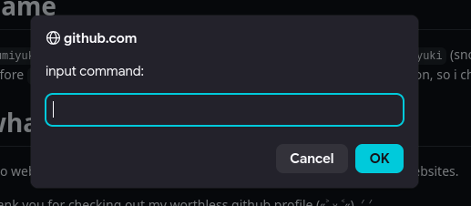
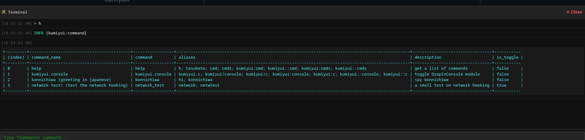
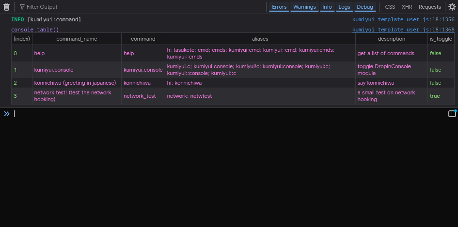
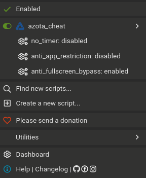
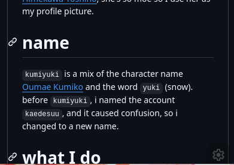
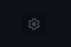

# Kumiyui User Manual
> [!note]
> i hate writing documentation, LLM is good at it, so I let it write.\
> thank you gemini-3 for writing the documentation.

> [!note]
> the {lang} documentation is translated by DeepL (MTL)

This manual provides instructions for interacting with the Kumiyui framework interface, executing runtime commands, managing script toggles, and configuring settings inside your web browser.

---

## Languages
| Language | Core Documentation | User Manual |
| :--- | :--- | :--- |
| **English** | [Developer Reference](../dev/README.md) | [User Manual](./README.md) |
| **Tiếng Việt** | none | [Hướng dẫn sử dụng](./README.vn.md) |

---

## Activating the Command Prompt

The primary control interface for Kumiyui is a text input dialog box that overlays the active webpage.

* **Default Keyboard Shortcut:** Press **`Shift` + `:`** (the colon character) on your keyboard.
* **Input Field Protection:** The activation listener automatically deactivates whenever your cursor is focused inside an input form, search bar, text area, or any editable document paragraph. This prevents accidental popups while typing normal text.



---

## Executing Commands

When the command entry box appears, you can run functions or inspect script features by typing registered keywords.

### Command Syntax Structure
Commands use a standard space-delimited pattern to pass arguments or modifiers:
```text
command_name [argument_1] [argument_2]
```

### Core Built-In Utility Commands

| Command Keyword | Alternative Shortcuts | Behavior and Purpose |
| :--- | :--- | :--- |
| **`help`** | `h`, `tasukete`, `cmd` | Outputs a structured index table into the browser console listing all active commands, names, and descriptions. |
| **`kumiyui.console`** | `kumiyui!c`, `kumiyui:c` | Re-points properties to toggle the visibility state of the custom on-screen graphical console panel. |
| **`kumiyui.disabledevtoolhelp`** | — | Suppresses the automatic browser alert reminders that prompt users to open developer tools during the `help` sequence. |

From built-in terminal (`DropInConsole`):



From Browser Devtool:



---

## Managing Feature Toggles

Certain commands act as stateful boolean switches to turn specific configurations or scripts on and off persistently.

1. **Prompt Invocations:** Entering a toggle-enabled command directly into the input prompt automatically flips its binary state (for example, shifting an active feature to inactive).
2. **Browser Extension Menus:** When running inside a userscript manager container (such as Tampermonkey or Violentmonkey), these toggles map directly into the extension's primary dropdown panel. Features display as `<command>: enabled` or `<command>: disabled` and can be clicked to modify values instantly.
3. **Configuration Persistence:** Selection choices commit immediately to the storage database layer. Your preferences are retained automatically across page refreshes and browser sessions.



---

## Mobile and Touchscreen Navigation

On mobile browser environments or touchscreen tablets where physical keyboards are absent, Kumiyui injects a hardware-responsive visual utility interface.

* **The Floating Action Icon:** A circular icon automatically renders in the lower-right quadrant of the viewport interface when touch pointer events are detected.
* **Opening the Interface:** Tapping this floating graphic node opens the command text prompt immediately, replicating the keyboard shortcut function.
* **Repositioning:** To clear views or blocked links, hold and slide the icon to move its coordinates anywhere across the display boundary layout.



You can see it clearly:



---

## Credits
* **kumiyuki:** Primary author, core architect, and developer of the Kumiyui framework. Designed and implemented the underlying code infrastructure, memory optimizations, environment configurations, and reverse-engineering hook pipelines (accounting for 90% of development).
* **Gemini (Google):** AI collaborator used for structuring, refining, and generating the user documentation templates.